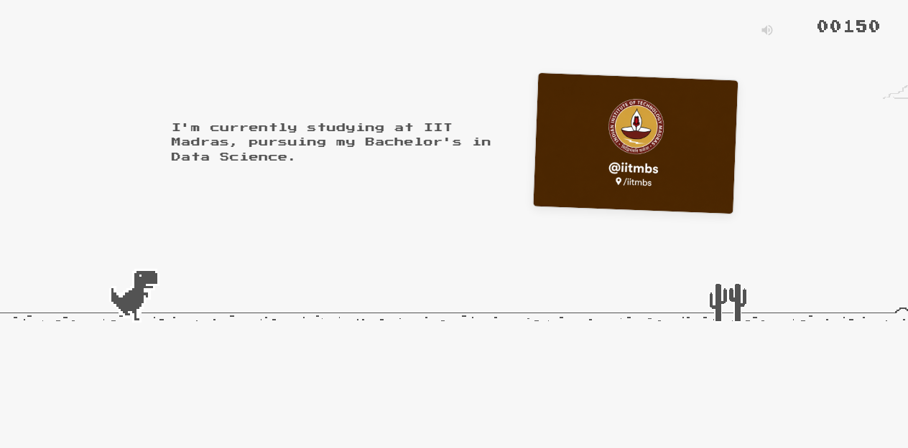
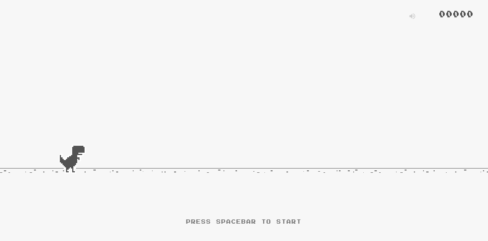
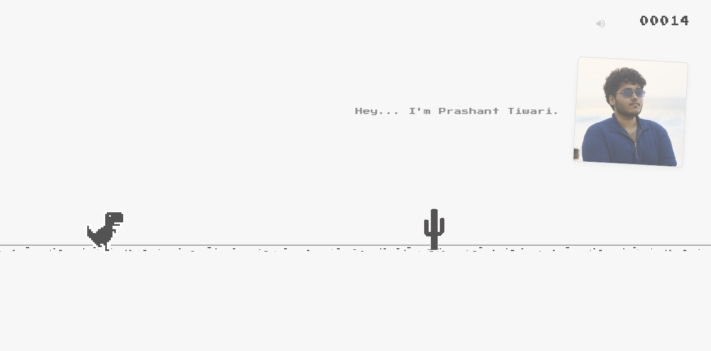
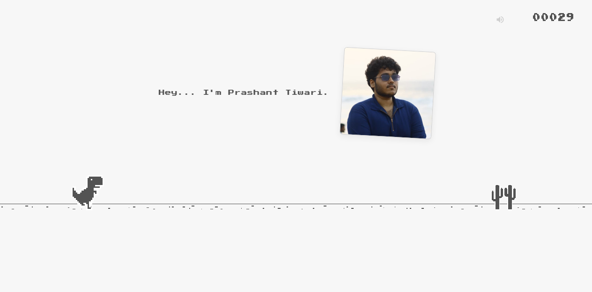
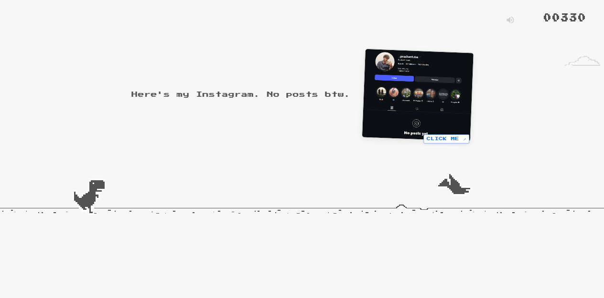
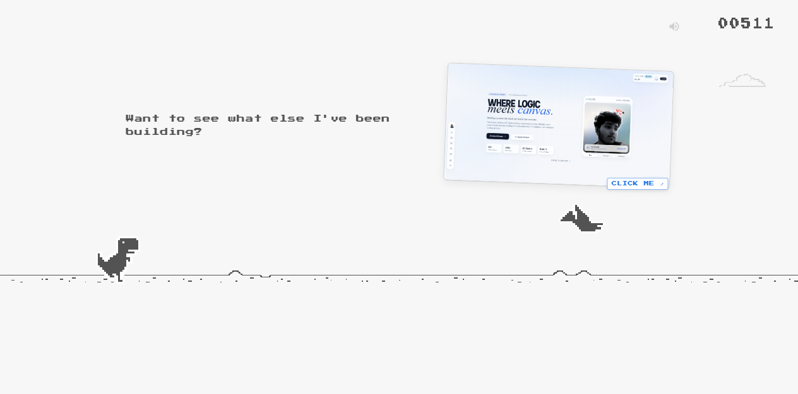
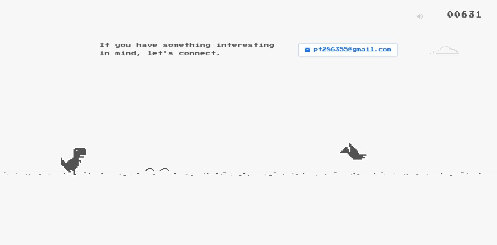
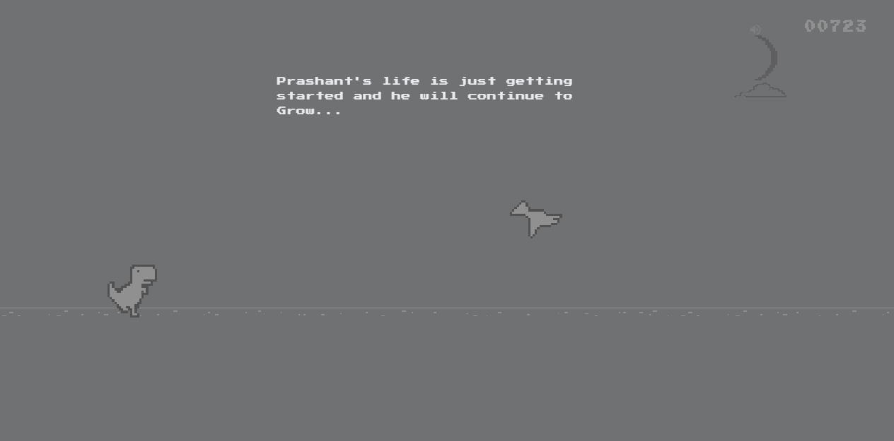
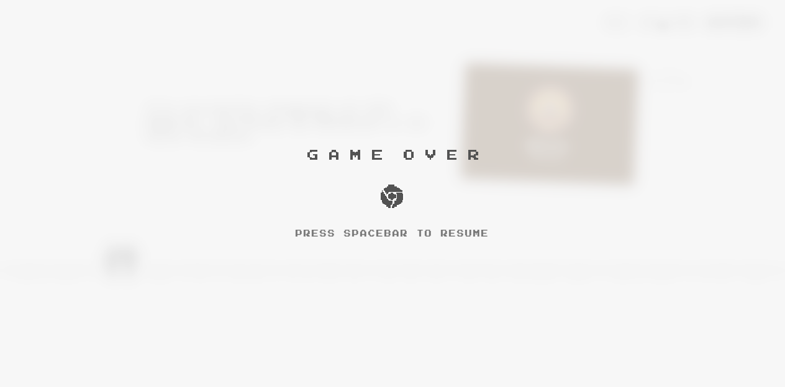

# 🦖 INTRO DINO

> **Not another portfolio. Just a dinosaur, a little running, and a story.**

[](https://developer.mozilla.org/en-US/docs/Web/JavaScript)
[](https://developer.mozilla.org/en-US/docs/Web/API/Canvas_API)
[](https://developer.mozilla.org/en-US/docs/Web/API/Web_Audio_API)
[](package.json)
[](css/styles.css)

[**▶️ Play Live Demo**](https://techy-prashant.github.io/Intro-Dino/) &nbsp;•&nbsp; [**💻 View Source Code**](https://github.com/Techy-prashant/Intro-Dino) &nbsp;•&nbsp; [**🌐 Personal Portfolio**](https://portfolio-v3-ten-gray.vercel.app/) &nbsp;•&nbsp; [**📬 Get in Touch**](mailto:pt286355@gmail.com)

---



---

## 💡 What is Intro Dino?

**Intro Dino** is a personal introduction website disguised as the classic, beloved Chrome Dinosaur runner game.

Instead of presenting another traditional portfolio cluttered with generic skill bars, cards, and self-congratulatory headers, **Intro Dino turns personal storytelling into an interactive, score-based arcade discovery**.

When visitors arrive, there is **zero portfolio identity**. No navigation, no personal name, no bio, no social badges. Just the familiar, minimalist offline dinosaur waiting on the ground line with a single instruction:

```
PRESS SPACEBAR TO START
```

The moment you jump, the journey begins. As your score ticks upward, personal story checkpoints physically travel across the game world. Every 60 points of survival reveals another chapter of Prashant's education, projects, startup journeys, creative experiments, and online spaces—all without interrupting the run.

**Run. Discover. Repeat.**

---

## 🎮 What Happens When You Visit?

The visitor journey is structured as a continuous horizontal narrative synchronized with the runner engine:

```
[ START SCREEN ]          [ EARLY RUN (25-145 pts) ]         [ MILESTONES (325-625 pts) ]         [ INFINITE HORIZON ]
Zero Identity       ──▶   Identity & Education         ──▶   Work, Socials & Portfolio    ──▶   Day/Night & Infinite Run
"PRESS SPACEBAR"          "Hey, I'm Prashant..."             Interactive Cards & Links            Cycles every 700 pts
```

1. **The First Glance (Zero Portfolio Identity)**:  
   The website opens directly into a crisp, fullscreen recreation of the Chrome Dino game environment. A calm light-grey background (`#f7f7f7`), the stationary pixel dinosaur, the horizon ground line, and `PRESS SPACEBAR TO START`.

2. **The Run Begins**:  
   Pressing **Spacebar** or tapping the screen dismisses the prompt and starts the run at a comfortable, snappy pace. Procedural ambient background music synthesized in real-time via the Web Audio API softly fades in.

3. **Continuous Traveling Narrative**:  
   At **25 points**, the first introduction glides into view from beyond the right edge of the screen, settles gracefully in the upper sky, remains centered for comfortable reading, and then journeys away beyond the left edge.

4. **Authentic Storytelling**:  
   As obstacles spawn and difficulty gently progresses, visitors discover Prashant's studies in **Data Science & Applications at IIT Madras**, experiences across agritech, marketing, and tech startups, live social profiles (Instagram, LinkedIn, GitHub), and portfolio projects.

5. **Day / Night Transitions**:  
   Every 700 points, the entire game world smoothly inverts into a deep, soothing night mode under a shifting moon with 7 lunar phases and drifting starfields.

6. **Loss & Gentle Recovery**:  
   If the dinosaur collides with a cactus or pterodactyl, the world doesn't reset to zero. Instead, the background screen and active narrative text **softly blur into an elegant depth-of-field bokeh**, while a crisp, centered `GAME OVER` emblem and interactive retry button appear with `PRESS SPACEBAR TO RESUME`. Resuming grants a **1.5-second safe invulnerability runway**, letting players keep their score and narrative progress!

---

## 📸 Website Showcase

| Initial Game Screen | Active Gameplay |
| :---: | :---: |
| <br><sub>**Zero Portfolio Identity**: Pristine Chrome Dino waiting screen with start prompt</sub> | <br><sub>**Active Gameplay**: Fullscreen running, obstacle spawning, and live score counter</sub> |

| Discovery 01 — Identity (25 pts) | Discovery 03 — Education (145 pts) |
| :---: | :---: |
| <br><sub>**Personal Introduction**: First checkpoint entering with enlarged tilted photograph</sub> | <br><sub>**IIT Madras**: Bachelor's in Data Science card traveling across the sky</sub> |

| Discovery 06 — Instagram (325 pts) | Discovery 09 — Portfolio (505 pts) |
| :---: | :---: |
| <br><sub>**Social Profiles**: Instagram discovery with interactive `CLICK ME` badge</sub> | <br><sub>**Portfolio Card**: Clickable project destination linked to live portfolio</sub> |

| Discovery 11 — Contact (625 pts) | Night Mode Cycle (700+ pts) |
| :---: | :---: |
| <br><sub>**Direct Contact**: Clickable email interaction directly inside the runner</sub> | <br><sub>**Night Mode Cycle**: Fullscreen invert transition with moon and starfield</sub> |

<div align="center">

### Soft Blur Game Over & Safe Runway Resume

*When the Dino collides, the background world softly blurs into bokeh, presenting an uncluttered retry modal with safe invulnerability resumption.*

</div>

---

## 🧑‍💻 Meet the Developer

<div align="center">

### **Prashant Tiwari**
*Builder • Data Science Student @ IIT Madras • Creative Technologist*

[](https://github.com/Techy-prashant)
[](https://www.linkedin.com/in/24f2001089/)
[](https://www.instagram.com/_.prashant.me/)
[](https://portfolio-v3-ten-gray.vercel.app/)
[](mailto:pt286355@gmail.com)

</div>

- 🎓 Currently pursuing a Bachelor's degree in **Data Science and Applications** from **IIT Madras**.
- 🛠️ Passionate about both the **creative** and **technical** dimensions of software development.
- 🚀 Has contributed to startups across **technology**, **agriculture**, **marketing**, and **creative media**.
- 💡 Loves experimenting with new ideas, building unconventional web experiences, and turning standard paradigms upside down.

---

## 🗺️ The Introduction Journey

Every checkpoint in Intro Dino triggers at a designated score milestone, traveling smoothly across the upper sky while gameplay continues uninterrupted:

| Milestone | Checkpoint Title | Narrative Content | Visual Media |
| :---: | :--- | :--- | :---: |
| **25 pts** | **Hello!** | *"Hey... I'm Prashant Tiwari."* | 📷 Enlarged Photo (Tilted) |
| **85 pts** | **A Little Introduction** | *"This is my little introduction."* | Text |
| **145 pts** | **Education** | *"I'm currently studying at IIT Madras, pursuing my Bachelor's in Data Science."* | 🎓 IITM Card (Interactive) |
| **205 pts** | **Interests** | *"I'm into creative and technical things."* | Text |
| **265 pts** | **Experience** | *"I've been part of startups across technology, agriculture, marketing and creative fields."* | Text |
| **325 pts** | **Instagram** | *"Here's my zero-post Instagram. I'll follow back. You follow, btw."* | 📸 Profile Card (`CLICK ME`) |
| **385 pts** | **LinkedIn** | *"Ah, here's my LinkedIn as well."* | 💼 Profile Card (`CLICK ME`) |
| **445 pts** | **GitHub** | *"And finally, here's my GitHub."* | 🐙 Profile Card (`CLICK ME`) |
| **505 pts** | **Portfolio** | *"Want to see what else I've been building?"* | 🌐 Portfolio Card (`CLICK ME`) |
| **565 pts** | **Opportunities** | *"Open to internships, fellowships, apprenticeships, research and exciting projects."* | Text |
| **625 pts** | **Contact** | *"Have something interesting in mind? Let's connect."* | ✉️ Clickable Email Badge |
| **685 pts** | **Keep Going** | *"Prashant's life is just getting started and he will continue to Grow..."* | Text |
| **745+ pts** | **The Non-Ending** | *"This is the last one btw. You can leave or enjoy the game :)"* | Infinite Runner |

---

## ⚡ Verified Features & Architecture

- **Faithful Chromium T-Rex Physics**: Jump curve calculated with authentic gravity (`0.48`), velocity arcs, variable jump heights, and fast drop ducking (`-4.0` velocity).
- **Multi-Box AABB Hitboxes**: Accurate collision detection using Chromium's exact internal 6-box T-Rex and obstacle collision geometries.
- **Continuous Traveling Narrative**: Hardware-accelerated CSS `translate3d` animation pipeline synchronizing DOM pool elements with the runner distance.
- **Soft Background Blur on Crash**: Collision triggers a photographic depth-of-field effect (`filter: blur(8px)`) across the game world and narrative cards, keeping the foreground `GAME OVER` modal crisp and uncluttered.
- **Resilient Resume System**: Unlike the standard Dino game that restarts from zero, players resume from their current score with a **1.5-second safe runway window** (nearby obstacles cleared and blinking invulnerability).
- **Procedural Ambient BGM**: Real-time ambient music synthesized using Web Audio API nodes (`OscillatorNode`, `GainNode`, `BiquadFilterNode`) and pre-rendered offline for zero lag.
- **Original Sound Effects**: Low-latency decoding of original Chromium game audio: `button-press.mp3`, `hit.mp3`, and `score-reached.mp3`.
- **Day / Night Invert Transitions**: Cycles every 700 points with smooth 1.5-second cubic-bezier CSS filters, dynamic moon phases, and horizon starfields.
- **Full Touch & Mobile Support**: Responsive scaling across mobile, tablet, and widescreen viewports with native touch handlers (tap to jump, lower-screen hold to duck, scroll prevention).
- **Zero Framework Footprint**: Built with pure vanilla JavaScript ES modules, Canvas 2D API, and semantic HTML5/CSS3.

---

## 🕹️ Controls

| Action | Keyboard | Touch / Mobile |
| :--- | :---: | :---: |
| **Start Game** | `SPACEBAR` or `↑` | Tap anywhere |
| **Jump** | `SPACEBAR` or `↑` | Tap upper 65% of screen |
| **Duck / Fast Drop** | `↓` (Arrow Down) | Touch & hold lower 35% of screen |
| **Resume after Crash** | `SPACEBAR` or `↑` | Tap retry button or screen |
| **Toggle Audio (Mute)** | `M` key | Tap speaker icon in top-right |

---

## 🛠️ Technology Stack

```
Frontend Architecture:
├── Rendering Engine    ──▶  HTML5 Canvas 2D Context (High-DPI pixel-perfect rendering)
├── Narrative Engine    ──▶  Vanilla ES6+ Modules (Decoupled, event-driven state machine)
├── Audio Synthesis     ──▶  Web Audio API (Procedural chord voicing & offline pre-rendering)
├── Styling & Motion    ──▶  Modern CSS3 (Backdrop-filter blur, CSS custom properties, transforms)
├── State & Storage     ──▶  LocalStorage API (High scores & persistent session tracking)
└── Testing Harness     ──▶  Chrome DevTools Protocol (CDP) + Headless Chrome Automation
```

---

## 🚀 Run Locally

### Prerequisites
- [Node.js](https://nodejs.org/) (v16.0.0 or higher recommended)
- Any modern web browser (Chrome, Firefox, Safari, Edge)

### 1. Clone the repository
```bash
git clone https://github.com/Techy-prashant/Intro-Dino.git
cd Intro-Dino
```

### 2. Start the local development server
Intro Dino has zero external dependencies! You can run the built-in static server directly:
```bash
npm start
```
*Or use any static file server of your choice:*
```bash
npx serve .
```

### 3. Open in your browser
Navigate to:
```
http://localhost:3000/
```

### 4. Run the automated test suite
The repository includes a comprehensive 20-test validation suite that verifies physics, jump heights, audio cooldowns, collisions, traveling narrative checkpoints, day/night transitions, and mobile controls:
```bash
npm test
```

---

## 📂 Project Structure

```
Intro-Dino/
├── .github/
│   └── workflows/
│       └── deploy.yml            # Automated GitHub Pages CI/CD workflow
├── assets/
│   ├── intro/                    # Photographic checkpoint assets
│   │   ├── intro_01_prashant.png # Prashant Tiwari photo
│   │   ├── intro_03_iitm.png     # IIT Madras card image
│   │   ├── intro_06_instagram.png# Instagram card
│   │   ├── intro_07_linkedin.png # LinkedIn card
│   │   ├── intro_08_github.png   # GitHub card
│   │   └── intro_09_portfolio.png# Portfolio preview card
│   ├── 100-offline-sprite.png    # Standard definition 1x sprite sheet
│   ├── 200-offline-sprite.png    # High-DPI 2x Retina sprite sheet
│   ├── button-press.mp3          # Original Chromium jump sound
│   ├── hit.mp3                   # Original Chromium collision sound
│   └── score-reached.mp3         # Original Chromium milestone sound
├── css/
│   └── styles.css                # Fullscreen styles, backdrop blur, night mode
├── docs/
│   ├── assets/
│   │   └── hero-banner.png       # Project showcase hero banner
│   └── screenshots/              # Documentation screenshots
│       ├── initial-screen.png    # Zero portfolio identity
│       ├── gameplay.png          # Active running
│       ├── introduction.png      # Prashant Tiwari intro
│       ├── education.png         # IIT Madras card
│       ├── social-profiles.png   # Social profile card
│       ├── portfolio.png         # Portfolio preview
│       ├── contact.png           # Contact email interaction
│       ├── night-mode.png        # Night cycle under the moon
│       └── game-over.png         # Soft background blur & retry modal
├── js/
│   ├── audio.js                  # Web Audio synthesizer & sound manager
│   ├── checkpoints.js            # Traveling narrative controller
│   ├── config.js                 # Checkpoint milestones & physics parameters
│   ├── engine.js                 # Core game engine loop & game over modal
│   ├── horizon.js                # Fullscreen ground, clouds, moon & score
│   ├── main.js                   # Application bootstrap
│   ├── obstacles.js              # Cacti & pterodactyl manager
│   ├── physics.js                # T-Rex physics & collision bounding boxes
│   ├── qrcode.min.js             # Standalone QR generator
│   ├── sprites.js                # Sprite definitions & hitbox coordinates
│   └── storage.js                # LocalStorage persistence manager
├── scripts/
│   ├── capture-docs-screenshots.js # Automated docs screenshot generator
│   ├── server.js                 # Built-in lightweight HTTP server
│   └── test-suite.js             # 20-test automated validation suite
├── index.html                    # Minimal HTML5 entry point
├── package.json                  # Project metadata and npm scripts
└── README.md                     # You are here!
```

---

## 📄 License & Attribution

- **Game Mechanics & Sprites**: Recreated from the open-source Chromium T-Rex runner project, originally created by Sebastien Gabriel, Alan Bettes, and the Chromium Team (licensed under the [BSD-3-Clause License](https://chromium.googlesource.com/chromium/src/+/main/LICENSE)).
- **Personal Introduction, Concept & Design**: Concept, continuous horizontal storytelling engine, ambient music generator, and custom presentation copyright © 2026 [Prashant Tiwari](https://github.com/Techy-prashant).

---

<div align="center">

**[⭐ Star this repository on GitHub](https://github.com/Techy-prashant/Intro-Dino) if you enjoyed playing!**

*Designed & Built with curiosity by Prashant Tiwari.*

</div>
